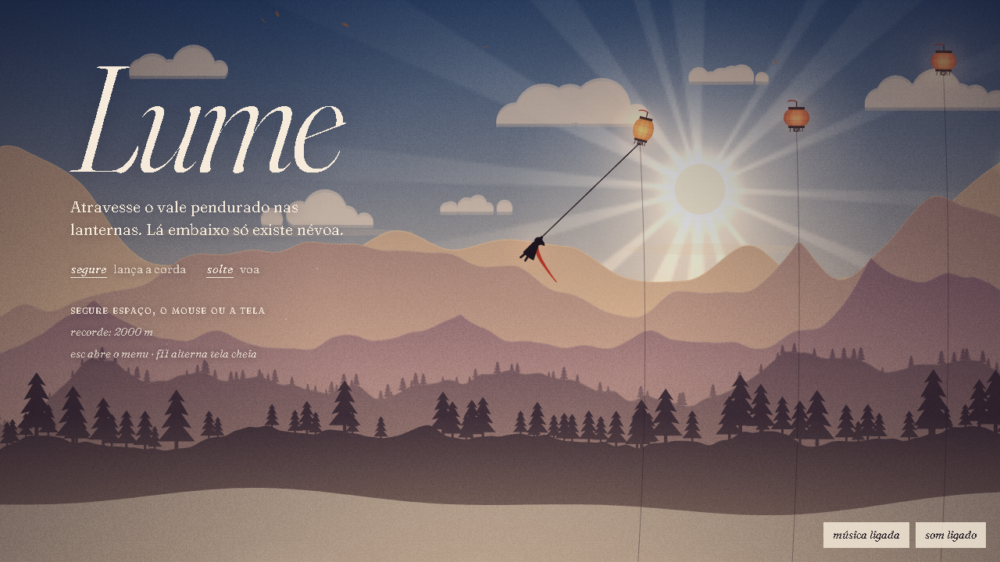
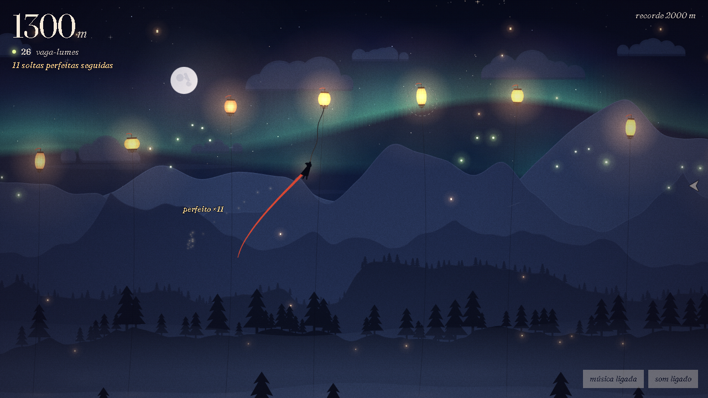

# Lume

Um jogo de um botão só. Você atravessa um vale pendurado em lanternas de papel; lá embaixo só existe névoa.





## Como se joga

- **Segure** (espaço, mouse, toque ou o botão A do controle) para lançar a corda na lanterna marcada pelo círculo pontilhado.
- **Solte** para voar. Se você soltar enquanto sobe para a frente, no momento em que a corda fica dourada, a solta é perfeita: dá impulso e o cachecol cresce.
- Vaga-lumes valem pontos. A distância é o que conta para o recorde, que fica marcado no vale por uma bandeirinha.

O caminho muda conforme você avança:

| A partir de | O que aparece |
| --- | --- |
| 200 m | Lanternas de papel branco, que pegam fogo pouco depois que você se pendura |
| 300 m | Caminho alto e caminho baixo |
| 400 m | Correntes de ar que te levam para cima |
| 450 m | Bancos de névoa, que você precisa passar por cima |
| 600 m | Corvos. De frente eles cortam a corda; caindo em cima, você quica |
| 700 m | Lanternas soltas, que sobem |
| 900 m | Lanternas que balançam |

O céu passa por tarde, entardecer, noite e aurora, e a trilha muda de tom junto com ele.

Teclas: `Esc` ou `P` abre o menu, `F11` alterna tela cheia, `M` liga e desliga a música, `N` liga e desliga os efeitos.

## Rodar

Precisa de [Node.js](https://nodejs.org) 20 ou mais novo.

```
npm install
npm start
```

Para gerar o executável do Windows em `dist/Lume-win32-x64/Lume.exe`:

```
npm run build
```

A versão web é o arquivo `game/lume.html` sozinho: abra no navegador.

## Como é feito

Nada de imagem ou áudio pronto. O cenário é desenhado em um canvas 2D a cada quadro (montanhas por ruído, pinheiros, nuvens, névoa em camadas, aurora) e todo o som é sintetizado com a Web Audio API, inclusive a trilha, que tem quatro progressões de acordes, melodia, baixo e bateria tocados por um sequenciador próprio.

- `game/lume.html`: o jogo inteiro, em um arquivo.
- `app/`: a casca Electron que vira o `.exe`.
- `tools/build.js`: monta a página do app com as fontes embutidas e empacota.
- `tools/sim.js`: joga centenas de partidas sem tela, com bots de habilidades diferentes, para medir a curva de dificuldade (`npm run sim`).
- `tools/playtest.js`: abre a página fora da tela, joga em tempo real e salva capturas.

## Licenças

Código sob MIT. A fonte [Fraunces](https://github.com/undercasetype/Fraunces) é distribuída sob a SIL Open Font License (`app/fonts/OFL.txt`).
